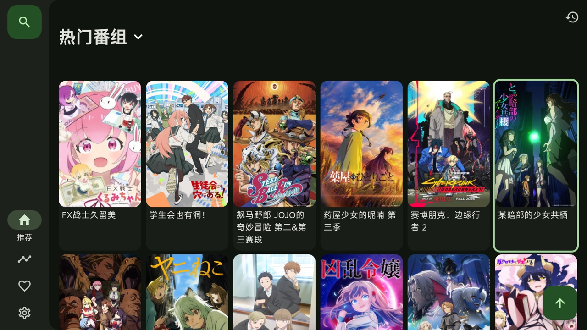
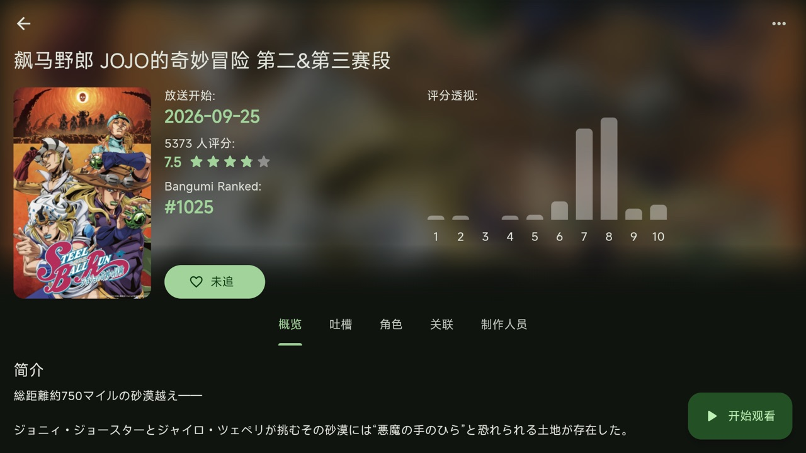
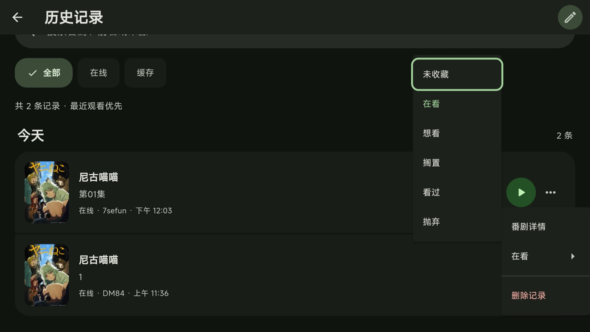
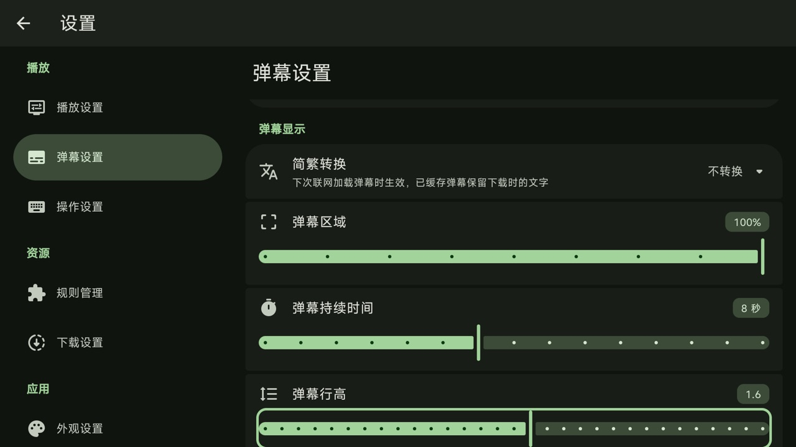

<div align=center>

<h1>Kazumi TV</h1>

<p><b>⚠️ 这不是 Kazumi 官方版本。</b></p>

<p>本仓库是 <a href="https://github.com/Predidit/Kazumi">Predidit/Kazumi</a> 的非官方分支，在原版的基础上为 <b>Android TV / Google TV</b> 适配了遥控器操作。<br>
番剧采集、规则、播放器等功能均来自原项目，本分支只增加了电视端的焦点导航与遥控器支持。</p>

<p>请不要向 Kazumi 官方反馈本分支特有的问题，相关问题请在 <a href="https://github.com/Jacob-SouthernCity/Kazumi-TV/issues">本仓库的 Issues</a> 中提交。</p>

</div>

## 屏幕截图

截图来自 Google TV 模拟器（1080p），绿色描边为当前遥控器焦点。

<table>
  <tr>
    <td></td>
    <td></td>
  </tr>
  <tr>
    <td></td>
    <td></td>
  </tr>
</table>

## 与原版的区别

基于原版 Kazumi 2.3.8（上游提交 `dc18be2a`），2026 年 10 月修改。所有改动只在检测到电视设备时生效，手机和桌面端的行为与原版一致。

- **出现在电视桌面**：注册为 Android TV 应用（Leanback 启动器、电视横幅），不再要求触摸屏。
- **焦点描边**：用遥控器移动时，当前选中的项目会显示描边，并随列表滚动。
- **侧边栏**：在内容区最左侧再按左键即可进入侧边栏（搜索、推荐、时间表、追番、我的）。
- **文本输入框**：方向键经过输入框时不再弹出键盘，按确认键才开始输入。
- **番剧搜索的筛选滑块**：区间滑块（评分、排名）按确认键开始调节下限，再按确认键切换到上限，第三次完成。
- **设置页**：
  - 滑块：方向键经过时只移动焦点；按确认键开始调节，左右键调节，再按确认键、返回键或上下键完成。
  - 开关和单选行只需按一次即可越过。
  - 下拉菜单打开后焦点会落在当前选项上。
- **菜单与返回键**：
  - 返回键一次只关闭一层菜单或子菜单，不会直接退出页面。
  - 历史记录等卡片上的「⋯」按钮可以选中。
- **播放器**：
  - 控制栏隐藏时：确认键暂停/播放，上下键呼出控制栏。
  - 进度条可以用遥控器拖动：左右键每次移动 10 秒并显示目标时间，停止按键后才跳转；控制栏隐藏时按左右键会直接选中进度条。
  - 控制栏显示时：方向键在进度条和各按钮间移动，返回键隐藏控制栏。
  - 选集面板打开后焦点落在当前集上，返回键关闭面板。
  - 支持遥控器媒体键：播放/暂停、快进、快退、上一集、下一集。

## 下载与安装

在本仓库的 [Releases](https://github.com/Jacob-SouthernCity/Kazumi-TV/releases/latest) 页面下载 APK：

| 文件 | 适用设备 |
|---|---|
| `Kazumi-TV-universal.apk` | **推荐**，适用于所有设备 |
| `Kazumi-TV-arm64-v8a.apk` | 仅 64 位系统 |
| `Kazumi-TV-armeabi-v7a.apk` | 仅 32 位系统（许多电视盒子，例如 Chromecast with Google TV） |

### 通过 U 盘安装

1. 在电视上打开开发者选项：设置 → 系统 → 关于 → 连续点击「Android TV 操作系统版本」7 次。
2. 从 Play 商店安装一个文件管理器（例如 X-plore 或 FX File Explorer）。
3. 允许该文件管理器安装未知来源应用：设置 → 应用 → 安全与限制 → 未知来源。
4. 插入 U 盘，用文件管理器打开 APK 并安装。

也可以通过局域网安装：`adb connect <电视IP>:5555`，然后执行 `adb install Kazumi-TV-universal.apk`。

### 注意事项

- **与官方版不能共存**：本分支与官方 Kazumi 使用相同的包名，但签名不同。如果电视上已经安装了官方版，需要先卸载官方版。
- **升级时请直接覆盖安装**：不要先卸载，这样历史记录、规则以及 WebDAV / Bangumi 同步登录都会保留。卸载会清除这些数据。
- **请始终使用同一种 APK**：三个 APK 的内部版本号不同，从 arm64 版换到通用版会被系统视为降级而拒绝安装。

## 已知限制

- **弹幕需要 API 密钥**：弹幕来自弹弹play 开放平台，需要 AppId 与 AppSecret。原版的密钥只存在于官方 CI 中，不会公开，本分支的 Release 是否包含弹幕取决于编译时是否配置了自己的密钥（见下方「配置弹幕」）。未配置时播放器不会显示弹幕，弹幕搜索会提示「此版本未配置弹弹play API 密钥」。
- **操作设置（自定义快捷键）**：录制按键时按下遥控器按键会被录入为播放器快捷键，建议不要在电视上修改快捷键。
- **测试范围**：主要在 Google TV 模拟器上测试，不同电视设备的表现可能有差异。

## 自行编译

需要 Flutter 3.47.7、JDK 21 和 Android SDK（含 NDK 与 CMake 3.22+）。

```bash
git clone https://github.com/Jacob-SouthernCity/Kazumi-TV.git
cd Kazumi-TV
flutter pub get
# ech_http 需要通过 ANDROID_HOME 找到 Android SDK 中的 CMake 与 Ninja
ANDROID_HOME=~/Library/Android/sdk flutter build apk --release --target-platform android-arm,android-arm64
```

### 配置弹幕

1. 前往 [弹弹play 开放弹幕网络开发者中心](https://dev.dandanplay.com) 注册账号，在「应用管理」中创建应用并提交审核，通过后获得 AppId 与 AppSecret（详见 [接入文档](https://doc.dandanplay.com/open/)）。
2. 复制密钥模板并填入，`secrets.json` 已被 `.gitignore` 忽略，不会被提交：
   ```bash
   cp secrets.example.json secrets.json
   ```
   ```json
   {
     "DANDANAPI_APPID": "你的 AppId",
     "DANDANAPI_KEY": "你的 AppSecret",
     "KAZUMI_APPID": "",
     "KAZUMI_KEY": ""
   }
   ```
3. 编译时传入该文件：
   ```bash
   ANDROID_HOME=~/Library/Android/sdk flutter build apk --release --target-platform android-arm,android-arm64 --dart-define-from-file=secrets.json
   ```

请遵守弹弹play 的 [API 使用约定](https://doc.dandanplay.com/open/)：按需调用、不得批量抓取、未经授权不得用于商业用途。`KAZUMI_*` 是原版「访问加速」镜像的密钥，仅官方持有，留空即可，不影响正常使用。

**注意**：密钥会被编译进 APK，公开发布的 APK 可以被他人提取。如需公开发布，请确认这符合弹弹play 对你的应用的授权范围。

检查代码：

```bash
flutter test
flutter analyze --no-fatal-infos --fatal-warnings
```

## 贡献

- **本分支的问题**：欢迎在本仓库提交 Issue 或 Pull Request。
- **上游的问题**：与电视无关的问题，请直接向 [Predidit/Kazumi](https://github.com/Predidit/Kazumi) 反馈，并遵守其 [贡献指引](static/doc/CONTRIBUTING.md)。
- **规则**：自定义规则请提交到官方的 [规则仓库](https://github.com/Predidit/KazumiRules)。

## 许可证与版权

本项目与原项目一样，基于 [GNU 通用公共许可证第 3 版（GPL-3.0）](LICENSE) 授权，源代码完全公开。

**图标**：Kazumi 应用图标来自 [Yuquanaaa](https://www.pixiv.net/users/66219277) 发表在 [Pixiv](https://www.pixiv.net/artworks/116666979) 上的作品，由原作者拥有版权，原项目已获得授权使用。该图标不是自由使用的，未经原作者明确授权，任何人不得擅自使用、复制、修改或分发。本分支新增的电视横幅为纯文字设计，未使用该图标。

**字体**：内嵌字体为 [Mi Sans](https://hyperos.mi.com/font/zh/details/sc/)，由 [Xiaomi](https://www.mi.com/index.html) 开发和拥有版权。

## 免责声明

本项目基于 GPL-3.0 授权。我们不对其适用性、可靠性或准确性作出任何明示或暗示的保证。在法律允许的最大范围内，作者和贡献者不承担任何因使用本软件而产生的直接、间接、偶然、特殊或后果性的损害赔偿责任。

使用本项目需遵守所在地法律法规，不得进行任何侵犯第三方知识产权的行为。因使用本项目而产生的数据和缓存应在 24 小时内清除，超出 24 小时的使用需获得相关权利人的授权。

## 隐私政策

与原项目相同：不收集任何用户数据，不使用任何遥测组件。

## 致谢

感谢 [Predidit](https://github.com/Predidit) 及 [Kazumi 的所有贡献者](https://github.com/Predidit/Kazumi/graphs/contributors)，本分支的全部核心功能都来自他们的工作。

原项目还依赖以下项目与服务：[XpathSelector](https://github.com/simonkimi/xpath_selector)、[弹弹play](https://www.dandanplay.com/)、[Bangumi](https://bangumi.tv/)、[Anime4K](https://github.com/bloc97/Anime4K)、[SyncPlay](https://github.com/Syncplay/syncplay)、[trace.moe](https://trace.moe)、[media-kit](https://github.com/media-kit/media-kit)、[avbuild](https://github.com/wang-bin/avbuild)、[hive](https://github.com/isar/hive)。
